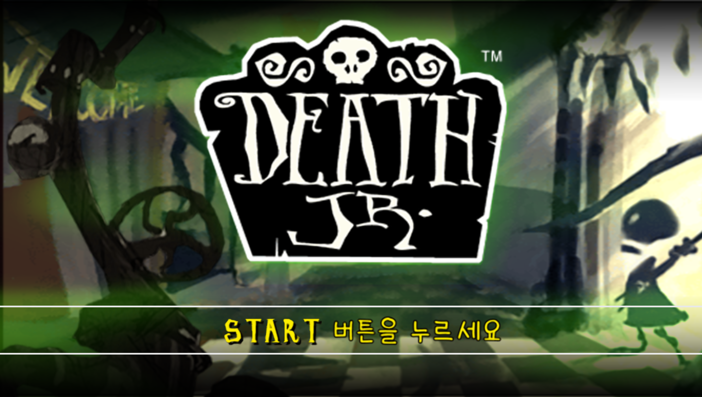

# 데스 주니어 — PSP

PSP **데스 주니어** 한글 번역 패치 프로젝트입니다. 사신의 아들과 친구들이 등장하는 액션 어드벤처 게임입니다.

> **최종 배포본 · 2026-10-16 · 원본 ISO 2종 지원**

<!-- game-preview:start -->

  

**타이틀 · 한글 시작 안내** — 기존 PPSSPP 타이틀 캡처. 로고는 원문이며 시작 안내는 한글입니다. 촬영 당시 버전과 최종 배포본의 일치 여부는 확인하지 않았습니다.
<!-- game-preview:end -->

## 다운로드 및 적용 방법

1. 아래 체크섬 또는 상세 안내와 일치하는 원본을 준비합니다.
2. [최종 배포 패치 다운로드](https://github.com/akuma815/psp-death-jr-kr-patch/releases/tag/final-20261016)에서 ZIP을 받아 모두 압축 해제합니다.
3. 원본 ROM 또는 ISO를 동봉 `apply.cmd`에 끌어다 놓습니다.
4. 생성된 한글판 파일의 SHA-256을 확인하고 실행합니다.

## 주의사항

- 미국판 ULUS10027 v1.01 원본 ISO 2종을 지원합니다. `apply.cmd`가 SHA-256으로 자동 선택합니다.
- 두 원본 모두 동일한 최종 한글판을 생성합니다. 게임 내용은 2026-09-26 최종본과 같습니다.
- 게임 번역과 4개 영상 자막을 포함합니다.
- 최종본의 실제 장면 및 전 구간 플레이 검수는 미완료입니다.
- 원본 게임·BIOS 및 패치가 적용된 게임 이미지는 포함하지 않습니다.

## 체크섬

| 구분 | SHA-256 |
| --- | --- |
| 원본 USA (PSP) (PSN), 435,159,040바이트 | `625c03e32b6757eb4e1ac382f43592d86778b3c943d4f26b95f1134ceee85ea3` |
| 원본 USA, 435,159,040바이트 | `644a57ff208d17ee4ec22ff06546f6d1e66bb3c88ca5f6ea91abb9e8edc22ff1` |
| 두 원본 공통 패치 후 이미지, 477,913,088바이트 | `c1ed1625cd3f9dac362655af0d332d49470fdab592c23cb5d81b778f4d52b842` |

배포 ZIP 및 각 패치 파일의 체크섬은 [최신 릴리즈](https://github.com/akuma815/psp-death-jr-kr-patch/releases/tag/final-20261016)와 동봉 `SHA256.txt`에서 확인하세요.
두 원본에 실제 배포 도구를 적용해 동일한 결과 해시를 확인했습니다. 새 에뮬레이터·전체 플레이 검수는 수행하지 않았습니다.

## 소스 및 작업 기록

[공개 소스 구성과 빌드 전제](docs/SOURCE_GUIDE.md) · [상세 패치 안내](docs/PATCH_GUIDE.txt)

[최종판 복원·소스 재빌드](docs/rebuild/README.md): 지원 원본 ISO·선택 폰트·공개 릴리즈로 자막 자산을 복원하고, 텍스트와 런타임을 소스에서 다시 빌드합니다. 과거 게임 폴더나 개인 복원 ZIP은 필요하지 않습니다.

[최신 작업 인계](docs/HANDOFF_2026-10-16.md)
