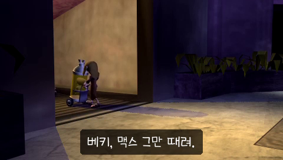

# 데스 주니어 — PSP

PSP **데스 주니어** 한글 번역 패치 프로젝트입니다. 사신의 아들과 친구들이 등장하는 액션 어드벤처 게임입니다.

> **최종 배포본 · 2026-09-26**

<!-- game-preview:start -->

  

**한글 영상 자막 · 미리보기** — 자막 삽입 영상의 QA 프레임. 에뮬레이터 실행 캡처가 아닙니다.
<!-- game-preview:end -->

## 다운로드 및 적용 방법

1. 아래 체크섬 또는 상세 안내와 일치하는 원본을 준비합니다.
2. [최종 배포 패치 다운로드](https://github.com/akuma815/psp-death-jr-kr-patch/releases/tag/final-20260926)에서 ZIP을 받아 모두 압축 해제합니다.
3. 원본 ROM 또는 ISO를 동봉 `apply.cmd`에 끌어다 놓습니다.
4. 생성된 한글판 파일의 SHA-256을 확인하고 실행합니다.

## 주의사항

- 미국판 ULUS10027 v1.01 전용입니다.
- 게임 번역과 4개 영상 자막을 포함합니다.
- 최종본의 실제 장면 및 전 구간 플레이 검수는 미완료입니다.
- 원본 게임·BIOS 및 패치가 적용된 게임 이미지는 포함하지 않습니다.

## 체크섬

| 구분 | SHA-256 |
| --- | --- |
| 원본 | `625c03e32b6757eb4e1ac382f43592d86778b3c943d4f26b95f1134ceee85ea3` |
| 패치 파일 `DeathJr_KR_Final_20260926.xdelta` | `e1c8d672355e6c41a712ba38c07d9502cfcb1c3496f68bcaad7c905b794f0394` |
| 패치 후 이미지 | `c1ed1625cd3f9dac362655af0d332d49470fdab592c23cb5d81b778f4d52b842` |
| 배포 압축 파일 | `1b3ee58e728cd07267329944619f92e0ca64ed8ad6e1c2ea452f38a71fdfaf8f` |

## 소스 및 작업 기록

[공개 소스 구성과 빌드 전제](docs/SOURCE_GUIDE.md) · [상세 패치 안내](docs/PATCH_GUIDE.txt)
